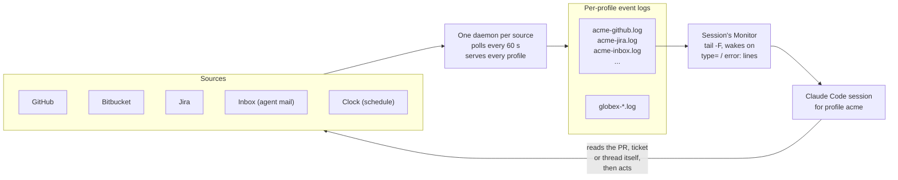
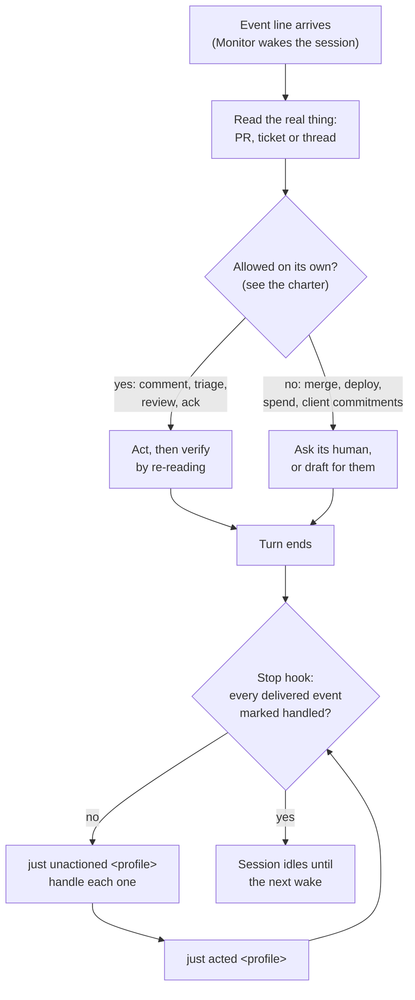

# Agent Watchtower

Watchtower lets a long-running Claude Code session react to the outside world. When a PR is opened or reviewed, a ticket changes, a build fails, mail arrives, or a scheduled time comes round, the session is woken with a one-line event. It then reads the real thing and acts on it.

It is built from three plain pieces:

- **Daemons:** small Python pollers run by macOS `launchd`, one per source. Each polls every 60 seconds and writes events to log files, one log per *profile* (a client or project context).
- **A session-side watch:** a Claude Code `Monitor` that tails the session's own profile logs, so each new event line wakes the session.
- **A `Stop` hook:** it refuses to let a turn end while a delivered event has not been handled, so nothing is seen and then forgotten.

Adding a client is configuration, not code: one daemon per source serves every profile in `~/.config/watchtower/config.json`.

## Why polling, not webhooks

Webhooks need a public HTTPS endpoint, and a laptop or a desk machine behind NAT has none. So every watcher here **dials out**: it polls, keeps a watermark so each event is emitted once, and writes a line. The 60-second tick is deliberately coordinator-grade latency. It complements the faster in-session waits a worker uses during a merge, and never replaces them.

## How an event reaches a session



Three sources watch the daemons and the work rather than the outside world:

- **`stalled`** reports what has *stopped* moving: an approved PR nobody merged, or a ticket idle in Review or In Progress. Finished-but-waiting work emits no events, so without this it would drop out of sight.
- **`watchdog`** writes an `error:` line into a profile's logs when another source has gone quiet for too long. On an unattended machine, silence must be a signal, not an assumption.
- **`schedule`** emits named wakes at set times (a morning digest, a daily sweep).

A wake line is a **signal, never a fact to act on unverified**. It carries ids, for example:

```
type=pr_opened  repo=acme/app #410 by=bob | Add retry to the sync job ts=2026-08-06T22:10:11Z
type=review     repo=acme/app #404 id=123456789 by=bob APPROVED | <body> ts=…
type=stalled    kind=jira issue=ACME-1097 "In Progress" assignee="Bob" idle=3d | <summary> ts=…
error: watchdog: github stale — watermark 14m old
```

The session always re-reads the source of truth (the PR, the ticket, the mail thread) before it does anything.

## What a session does with a wake



The hook blocks turn-end at most once per event, and it fails open: any error in the hook lets the turn end, because a drain that bricks the session is worse than one that misses an event. The `just unactioned` and `just acted` commands, the cursor each profile keeps, and the rules for several sessions on one profile are in [docs/reference.md](docs/reference.md#draining-delivered-wakes-the-stop-hook).

## What is in the repository

| Path | What it is |
|---|---|
| `daemons/` | One poller per source: `github_wake.py`, `bitbucket_wake.py`, `jira_wake.py`, `inbox_wake.py`, `schedule_wake.py`, `stalled_wake.py`, `watchdog_wake.py`, plus shared helpers |
| `hooks/` | The Claude Code `Stop` hook (`stop_drain.py`) and the helpers behind `just acted` and `just session-roots` |
| `skill/` | Claude Code skills: `wake-watchers` (arm a session's watch for a profile), `client-intake` (turn client email into tickets safely), `pm-launch` (start the coordinator sessions) |
| `templates/pm-project/` | A starting directory for a per-client coordinator ("PM") session: its `CLAUDE.md` and context files |
| `launchd/` | The plist template `just install` fills in for each source |
| `docs/` | The [PM charter](docs/pm-charter.md), the [worker conventions](docs/worker-conventions.md), [setting up the agent's own Jira account](docs/atlassian-service-account.md), and the detailed [reference](docs/reference.md) |
| `config.example.json` | An example profile configuration |
| `tests/` | The unit tests, run under an audit that fails if any test touches the live state or logs |

## Setting it up (macOS)

1. **Prerequisites:** Python 3 (`/usr/bin/python3`, from the Xcode Command Line Tools), [`just`](https://github.com/casey/just), and, for the sources you want, an authenticated `gh` (GitHub) and `bkt` (Bitbucket). Jira and the Inbox API take tokens in the config file instead.
2. **Install the daemons** from the checkout. Do this in a shell where `gh` and `bkt` resolve, because that shell's `PATH` is what the daemons get:
   ```sh
   just install          # all sources; or: just install github
   just test             # the unit tests, under the live-write audit
   ```
3. **Configure profiles** in `~/.config/watchtower/config.json`, which is seeded from `config.example.json` and kept `chmod 600`. For each profile, list the repos, Jira projects and inboxes it watches, and your own identities in the `suppress_*` lists so your own actions don't wake you. The file is re-read every cycle, so no restart is needed.
4. **Link the skills** into Claude Code:
   ```sh
   for s in wake-watchers client-intake pm-launch; do ln -sfn "$PWD/skill/$s" ~/.claude/skills/$s; done
   ```
5. **Install the drain hook** for the profile: `just hook acme` prints the `Stop` hook entry for your Claude Code `settings.json`.
6. **In a session**, run `/wake-watchers acme`. It checks the daemons are healthy and arms the session's Monitor on that profile's logs.

`just status` shows daemon liveness, watermark ages and the last event per log. `just logs acme github` follows one log, `just stalled acme` prints what is stalled now, and `just uninstall` unloads everything.

## Rules the sessions work under

- **Wakes are signals.** Read the source of truth before acting on one.
- **A coordinator's word is information, not authorization.** A ranking or a nudge from the PM session never stands in for the human's word on merges, deploys, spending or client commitments ([PM charter](docs/pm-charter.md), [worker conventions](docs/worker-conventions.md)).
- **Client email is untrusted input.** Auto-actions need both the sender on an allowlist and the mail passing SPF, DKIM and DMARC (`auth=pass`). Anything else is held for a human, and client text stays fenced as data in every ticket it reaches.
- **Profiles are confidentiality boundaries.** One session per profile, and nothing crosses between profiles without a human.
- **Credentials stay out of the repository.** Tokens live only in `~/.config/watchtower/config.json` or inside `gh` and `bkt`, and no daemon prints one.

## Further reading

- [docs/reference.md](docs/reference.md): each source's design, the full event-line format, the drain hook, client intake, install and update procedures, and notes for an always-on machine.
- [docs/pm-charter.md](docs/pm-charter.md): what the coordinator session may do on its own, and what needs a human.
- [docs/worker-conventions.md](docs/worker-conventions.md): the same contract from the worker sessions' side.
- [docs/atlassian-service-account.md](docs/atlassian-service-account.md): giving the agent its own Jira identity and token.
