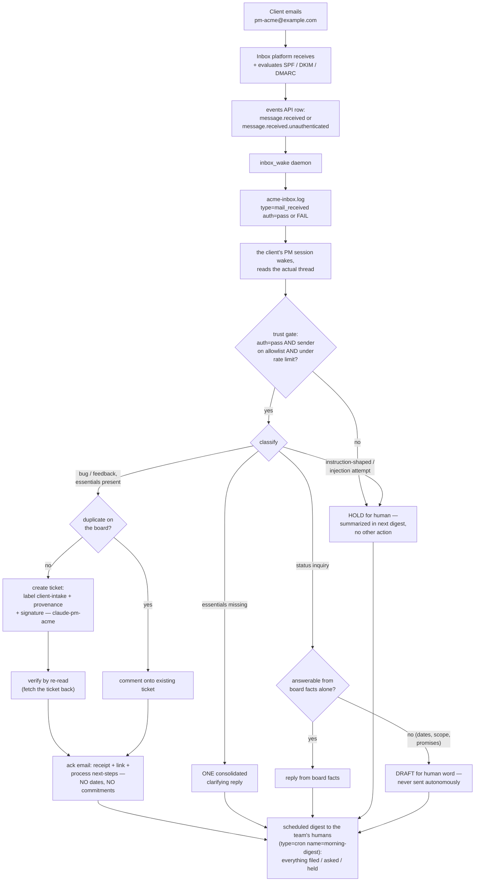

# Agent Watchtower — reference

The detailed design behind each source, the event-line format, the drain hook, client intake, install and update procedures. Start with the [README](../README.md) for the overview.

## Design notes, source by source

Every arrow into a session is a *wake with ids*; the session then reads the source of truth
directly (board, PR, thread) before acting — wake lines are signals, never facts to act on
unverified.

```
~/.config/watchtower/config.json        profiles: which repos/sites each context watches (chmod 600 — holds the Jira token)
~/Development/Agent-Watchtower/daemons/ one poller per source type, multi-profile
~/Library/LaunchAgents/com.watchtower.<source>.plist
~/Library/Logs/watchtower/<profile>-<source>.log   ← sessions tail these
~/.local/state/watchtower/<source>/<profile>.json  durable watermarks + dedupe
```

- **One daemon per source**, however many profiles: a single GitHub poller serves `acme`,
  `globex`, and anything else in the config. Adding a client is config, not code.
- **Seven sources**: `github`, `jira`, `bitbucket` (forge + tracker activity), `inbox` (agent-mail
  arrivals — per-inbox by nature, so each profile lists exactly the addresses its session
  answers for; the address IS the routing key), `schedule` (cron-style named wakes: digests,
  stale sweeps, SLA nudges — the one source that isn't reactive), and `watchdog` (emits
  `error:` lines into an affected profile's log when a sibling source's watermark goes stale —
  on a headless box nobody is staring at, silence must be a signal, not an assumption).
- **`stalled` polls for the ABSENCE of change**: every other source emits on an event, so
  an artefact that is finished and merely waiting emits nothing and falls out of every round
  (a complete PR sat unmerged 16 days). Per profile it computes the stalled set — open PRs with a
  standing verdict, and tickets in Review or In Progress (assigned or not), all idle ≥ `days` —
  and emits `type=stalled` on entry, `stalled_still` once a day while it persists, `stalled_cleared`
  on leaving. `idle` counts from the *verdict* for a PR (the latest approval or changes-requested),
  not from its last touch — a bot comment or an author's push must not hide a standing verdict —
  and from semantic work-state evidence for a ticket: its transition into the current watched
  status, plus any later assignee change while In Progress. An Epic also takes the latest such
  activity from each direct child. Comments, labels, links, summary edits, and other bookkeeping
  do not reset that clock. A source that does not answer neither adds nor clears
  (a broken query must never read as *nothing stalled*); a tier waiting on config (a placeholder
  token) is not checked and says so, without escalating. A fresh install's first cycle emits the
  existing set; a restart with state on disk re-announces nothing. Report-only by construction:
  the seat decides. `just stalled <profile>` prints the same set on demand. A GitHub repo that
  answers with nothing looks healthy, so the daemon log also carries a census line whenever a
  repo's numbers change: `census github <repo> reachable=1 open=6 binding-readable=6`.
  `reachable` is 1 if the repo has ever had a PR. It cannot fall back to 0 unless the fetch broke,
  and a 1 → 0 change is marked `(was reachable=1)`. The census makes that failure visible; it
  does not alert on it.
- **Cross-repo pairs are declared, not hoped for**: two changes that must land together
  carry `Lands-with: owner/repo#N` in *both* PR bodies, and the safe half — the one inert alone,
  usually the consumer or daemon side — merges first. `github_wake` reads the trailer: a half that
  merges while its companion is still unmerged emits `type=pair_window_open` at that moment, and
  `stalled_wake` lists the half-landed pair (`kind=pair`, from the merge, no idle threshold) until
  the companion merges. A companion that cannot be fetched is a hole, never a closed window — and
  a check that fails at merge time is retried every cycle until it answers. The companion is part
  of the stalled key (two trailers are two windows), and `pair_days` (default 14) bounds only
  *discovery*: a pair once on record — or one whose check has not been answered yet — is re-read
  by number until its companion merges. On every re-read the origin's *body* is the declaration:
  a trailer corrected after a failed check is what gets asked next; a withdrawn one retires.
  **The companion is a GitHub pull request** — `owner/repo#N`, a full
  `https://github.com/owner/repo/pull/N` URL, or `#N` for the same repository; a Bitbucket half is
  declared in prose and by the GitHub half's trailer. A companion that cannot be fetched holds
  *its own* pair (and keeps a `degraded sub=pairs` line open); every other pair still reconciles.
  A line that starts `Lands-with:` but does not parse is announced as
  `type=pair_trailer_unparsed` when the PR opens and again when it merges, so a typo is told to
  its author instead of degrading back to prose. At most 8 declarations per body.
  **A declaration is an UNINDENTED line** — column zero — which is the whole of the rule and
  the one thing authors must change. An indented trailer stops being a declaration at any nesting
  depth, so list items, blockquotes and continuation paragraphs are all retired as accidental
  declarations without parsing Markdown at all; an indented line is still *seen*, and surfaces as
  `type=pair_trailer_unparsed`, never silently dropped. Only BALANCED fenced blocks are skipped —
  backtick *or* tilde, any fence length, 0–3 leading spaces — so a PR that DOCUMENTS the trailer
  does not declare one. An example at FOUR+ spaces is inside a list or an indented block rather
  than a fence, so it is reported instead of silenced — report-only, and any rule quiet enough to
  hide it would also hide someone who indents a REAL trailer.
  **Opening and closing are different rules, deliberately.** Opening keeps the 0–3 indent and
  accepts list markers (`- ```sh`, `10. ```sh`), since a marker is not indentation. Closing accepts
  ANY indent — a fence under `10. ` has its closer at four spaces — and still refuses a marker,
  because inside a fenced `diff` block a line like `- ``` ` is content. The asymmetry is the fix
  for a bug that arrived four times in different clothes: an opener the scanner cannot SEE leaves a
  closer it CAN see, that closer becomes a phantom OPENER, and the next real fence closes the
  phantom — stripping every line between them, a real declaration included, silently. A phantom is
  always an opener, so the closer is the side that can safely be relaxed: it is consulted only
  while a fence is already open, and therefore cannot invent a span. Its indent is bounded by its
  opener's — at most three past it — because an unbounded closer let a `    ~~~` sitting as
  *content* inside a tilde fence close it early.
  ⚠ **One shape is known to still lose a declaration**: a fence opening at four spaces under a
  list paragraph, with its closer at three. It takes inconsistent indentation inside one block —
  written with both ends at four it parses correctly — and it is not wholly silent, since the
  example inside it is reported as an unparsed trailer. Tracked pairs are unaffected: the
  retirement predicate reads the raw body. **An unclosed fence deliberately skips NOTHING.** That reads
  backwards until you ask which consumer is unprotected: over-stripping is safe for a TRACKED pair,
  because the retirement predicate below holds the window open on a bad parse — but discovery has no
  predicate at all. Nothing is tracked yet, so an over-strip means the pair is never found, silently
  and permanently, while a false window is loud and someone closes it. Conservative is not a property
  of a rule; it is a property of a rule plus a consumer.
  ⚠ **Migration.** Previously a leading-whitespace trailer was a working declaration. It is not
  one now, so a tracked pair whose origin body indents its trailer moves to the hold branch:
  `degraded sub=pairs`, promoted to an `error:` line on the third consecutive cycle, until the
  companion merges or a human unindents it. `pair_trailer_unparsed` fires on the open and merge
  paths, and on this re-read path once per pending entry for each value the entry has not told
  (a value the merge path already told is not told again by its retry; an entry saved
  before that change has no record of what it told, so it tells its unparsed values once more after
  the update, then not again) — if you meet a
  `degraded sub=pairs` on a pair that predates this rule, look for an indented `Lands-with:` first.
  (Checked against the four live PR bodies in flight at the time: none is affected.) Line endings are
  normalised before parsing: a body written through GitHub's web form is CRLF, and previously
  that parsed to nothing and could clear a still-open window. **Retiring a tracked pair takes
  positive evidence.** A body that declares something else retires the old companion; a body with
  nothing trailer-shaped in it was genuinely withdrawn and clears; but a trailer-shaped line the
  parser cannot read HOLDS the pair, emits `degraded sub=pairs`, and is retried — because "I could
  not read it" and "it is not there" are different facts, and only one of them is a withdrawal.
- **Context lives at the session end**: the acme session arms Monitors on
  `acme-*.log`; the globex session on `globex-*.log`. Same daemons.
- **Echo suppression**: events authored by your own identities (configured per source) are
  recorded but not emitted — otherwise every agent write wakes the agent that wrote it.
- **Downtime coverage**: `since=`/`created>=` filters (GitHub), a gap-stretching JQL window
  (Jira), and snapshot diffing (both) mean a sleep of any length is covered on resume, up to the
  page limits of each read. Runs are paged back at most 100 per repo a poll, and a hit with a new
  window is told by a `type=unread_runs reason=page_cap` line (below). The PR listing and each
  PR's reviews are one page each. Comments are asked for per endpoint (issue
  comments, PR review comments) per repo, oldest first, from the watermark less 5 minutes, but never
  from before the first run's start, 30 to a page. A further page is requested only
  after a full one, up to 5 pages (150 comments) per endpoint per repo, so the steady state is one request
  per endpoint: 2 comments requests a repo a poll, and at most 10 after a long downtime. After a downtime, or a streak of failed cycles, more than 150 on one endpoint of one repo
  leaves the rest unread, and those older than 5 minutes when the watermark next moves are never
  announced; that is told by a `type=unread_comments reason=page_cap` line (below), once per episode.
  A later page that fails is recorded as a `comments` hole and keeps the pages read before it.
  First run seeds a baseline silently — no history replay. A sub-fetch that fails in the first run
  leaves its slice unseeded, so: an open PR whose reviews it could not read is remembered
  (`reviews_unseeded` in the state file), and when its reviews first answer, those submitted at or
  before the first run's start are seeded silently and a later one, or one with no readable time,
  is announced; and the comments window never reaches behind the first run's start, so
  the comments made in the 5 minutes before a first run whose comments fetch failed are not
  announced. A first run whose runs listing fails still announces page one at the next
  poll (below).
- **Scheduled runs**: a scheduled run that succeeds while its workflow was already
  passing is cron noise and is not announced; a scheduled run that does not succeed, the first
  scheduled success after one, and every push, PR or manual run are. The baseline is the last
  *scheduled* conclusion per repo and workflow name (`wf_last` in the state file,
  `{repo: {name: conclusion}}`). Keyed by name alone, as it was
  before that change, a scheduled success in one repo suppressed the real recovery of another repo's
  workflow of the same name. A state file from before that change is migrated on load: each name-keyed
  entry is copied to every repo the file records under `prs`, so each repo's first comparison is the
  one the old code would have made. A rollback reads no baseline at all, so a workflow that was
  failing when it happened has its scheduled recovery suppressed as if it had been passing.
- **Runs that outlive the page**: the runs poll reads only the 20 newest runs, so a
  long CI run can fall off it before it finishes, and its completion used to be lost outright.
  - A run seen in flight is remembered, saved with the state, and fetched by id until it completes.
  - At most 10 such fetches run per repo per cycle, and a run is tracked for at most 72 hours.
    The worst case is therefore 10 extra REST calls per watched repo per minute, while more than 10
    runs sit off the page unfinished (queued or waiting). The daemon log says so whenever the cap
    defers runs. Which ten rotates, least recently attended first: a run's last check, or,
    never checked, when it was first tracked. Runs parked on queued or waiting cannot starve the
    completions behind them, and newly tracked runs cannot push every re-check back. The rotation is
    saved with the state, so a restart does not reset it. A run waits about one cycle per ten runs off
    the page ahead of it.
  - A 404 drops the run, in the daemon log only. Any other failed fetch is `degraded sub=runs` and is retried.
  - A run still not completed after 72 hours is dropped, and told: `type=unread_runs reason=retired
    run=<id>`, written before it is dropped, so a run whose fetch keeps failing, or whose repo's
    other listing is dead, is not lost silently. A run legitimately parked that long (a deploy waiting on
    approval) gets one such line. The status listing (`in_progress`, `queued`) tracks a run that is
    still going in one of those states again on the next cycle, so the line is told once per run and
    attempt, remembered in `seen`, which is saved with the state: neither the re-tracking nor a restart
    repeats it. A run parked at `waiting` (a deployment gate) is in neither listing and, once off the
    newest page, is not tracked again after it is dropped: it is told once, and tracked again only when
    it shows up on the newest page or in a status listing (a re-run, a later attempt). The attempt in
    that memory is the one saved with the run (`runs_attempt`, beside `runs_inflight`), read from the
    listings where the run joins and from each by-id answer, so a later attempt is told on its own; a
    run whose attempt was never seen is keyed `?`.
- **Runs created between two polls**: a run created after one poll and pushed off the newest
  page by 20 or more newer runs before the next was never seen at all, so the in-flight tracking above never tracked it. A
  seven-merge wave created 49 runs in about a minute and lost 3 of 7 CI@main completions.
  - Each poll pages back, 20 runs a page, until a page's oldest run was created before the previous
    poll began, less 2 minutes (clock skew, and a run listed a little after it was created). Pages are
    contiguous, so a COMPLETE read skips nothing created since. A restart pages back to the saved
    watermark.
  - From the deeper pages it takes runs still going (a re-run too, though it keeps its old
    `created_at`), runs already tracked, and completed runs created since that cutoff. Older history on
    the last page is left alone, so nothing is replayed; a completed run with no usable `created_at`
    cannot be proven new and is left alone too.
  - **The first run** reads page one only and stamps `runs_baseline_at`. No later page-back reaches
    behind it, so a fresh install, or a lost state file, after a burst replays nothing.
  - **A read that is not complete holds the cutoff** for that repo (`runs_from` in the state file): a
    failed listing or deeper page, a `workflow_runs` that is missing, null or holds a non-object, or a
    full page with no usable `created_at`. Each is `degraded sub=runs`, and the next poll pages back to
    where the incomplete read began, asking the listing from the cutoff's own date, so a hold open
    across 00:00 UTC is read too. `degraded_recovered sub=runs` after a hole means the runs behind it
    were read, unless a `type=unread_runs` line was written first. A hold more than 30 minutes old is
    still read from once, so the first poll back from a long downtime, or from a total outage (whose
    cycles fail before they reach the runs), heals it; only if that read is incomplete too is it
    released, told: `type=unread_runs reason=hold_expired`. That is what a runs listing that keeps
    failing while the rest of the cycle answers comes to. While a repo is held, the run ids in
    `seen` that its read can still return are exempt from the cap, so runs announced behind the
    failing page are not forgotten and announced again when it answers: every run key touched or
    announced in that repo since the hold began, less the cutoff's margin. The state file's
    `runs_recent` keeps `{run key: cycle start}` per repo, held or not, so the margin before a hold
    opens is covered too; it is trimmed each cycle to the hold's start less the margin (to this
    cycle's start less the margin when there is no hold). Every other run id is pruned to the cap,
    so the run ids in `seen` hold at most the cap plus the exempt set however long holds keep
    reopening.
  - **At most 5 pages (100 runs) per repo per poll.** EVERY hit with a new window is told by its own
    `type=unread_runs reason=page_cap since=… until=…` line, outside the degraded rate limit. The cap is
    judged from the read's cutoff: the last completed cycle's start less the margin, or, while an
    earlier failed read is held, the hold's start less the margin, and never earlier than the first
    run's start. So one burst past it is re-read,
    and re-told, on the next poll or two, and about 100 runs in three minutes can report "may be
    unread" when the margin's re-read already covered them (measured: 34 runs a minute for
    10 minutes writes 8 such lines with every run announced once). A hit whose `since` and `until`
    both repeat the last line for that repo (a cycle that keeps failing, so the watermark is frozen)
    is not written again; that memory is saved with the state, so a restart inside a
    frozen streak does not write it again either.
    A cap hit does not hold the cutoff: re-reading the same newest pages would only hit it again. Check
    the window by run id.
  - A failed PR listing still fails the whole cycle, as before: the watermark does not move,
    so nothing the failed cycle missed is skipped (up to the page limits of each read, above), a
    first run keeps its baseline, and a total outage
    is `error: github polling failing repeatedly` with a stale state file. Comments made across it are
    included up to the comments limit above (5 pages of 30 per endpoint per repo, asked from the
    frozen watermark less 5 minutes): past the 150th on one endpoint of one repo in one streak, those
    older than 5 minutes when the watermark moves are never announced, and the
    `type=unread_comments` line says so once. While the
    watermark is frozen each poll re-reads the same runs window, at up to 5 listing requests a repo.
    The guard above keeps an unchanged window from being written again; it does not keep the cap
    line from repeating: each poll in which the 100th newest run's creation second has moved
    writes one more line (review 5388824801 measured 0 lines in 4 hours at 90 runs, 11 at 110 and
    147 at 300).
  - The steady state is still one listing request (not counting the two status listings below): a short page, or one that reaches past the previous poll,
    ends the page-back. A burst costs up to 5 listing requests in each of the polls that re-read it.
  - Residuals besides the cap: a host clock more than about 150 s AHEAD of GitHub stops the
    page-back from reaching runs it should (measured skew: 0 s); and a first cycle whose runs
    listing fails seeds nothing, so the next poll announces page one. The last is as before.
  - **A re-run of an old run**: a re-run keeps its run's original creation time, so it sits
    among the old runs of the listing, behind pages the page-back never reads, and once an attempt was
    announced the run was no longer tracked, so a later attempt (attempt 3 of a PR's CI run) was never
    announced. So every cycle also lists, per repo, the runs going NOW by status, `in_progress` and
    `queued`, the newest 100 of each (`RUNS_STATUS_PER_PAGE`, their own page size, not the plain listing's)
    with no date filter (GitHub's status is the current attempt's, so an old run's new attempt is listed;
    it is last in a newest-first list, so a small page could hide it behind newer runs going). A status
    answer that comes back full may have more runs behind it, which are not read: the daemon log notes
    it every cycle, and a `type=unread_runs repo=… reason=status_cap status=…` line is written once per
    repo and status while the answer stays full, and again after an answer that was not full (that memory
    is kept in the running process only, so a restart tells a still-full answer once more). Whatever is not completed is tracked in flight exactly as a
    run on page one is, and the by-id fetch settles it. This is **two more requests per repo per cycle**,
    in the quiet steady state too, which is what a repo costs now: three requests, not one. A status
    listing that fails is `degraded sub=runs` and is retried next cycle; it does not hold the page-back's
    cutoff. It also tracks the runs still going behind page one at a first run (up to 100 in progress
    and 100 queued), which were not tracked before. Still open, never observed: attempt N+1 starting
    between two by-id fetches of attempt N, so attempt N's completion is never seen. Also open: a
    re-run that starts and finishes between two polls is never listed by status, a run listed by status is still fetched by id when it is off the plain listing's pages (a redundant
    request for a run already in hand), runs in the `waiting` and `pending` statuses are not listed,
    and the status listings send no ETag.
- **A restart re-announces nothing**: the ids already announced are remembered per kind
  (`review:`, `run:`, `c:`), refreshed whenever the API returns them and evicted oldest-first at the end
  of every cycle, so a restart reloads what the running daemon knew, inside a streak of failed cycles
  too (below). They used to be cut to an arbitrary
  2000 on save. Per watched repo the caps are 600 reviews, 200 runs and 1800 comments, derived in `SEEN_CAPS`
  (a comments window is 2 endpoints x 30 x 5 pages, held for the six polls an id stays returnable).
  - `seen` stays a flat list, now oldest-first, beside `seen_v: 2`; the previous code still reads it. A
    rollback loses the order, and a later roll-forward repeats the adoption below.
  - A value in the state file that is not the shape the cycle reads (a null or a list where an object
    belongs, an entry of the wrong type, or a timestamp within a day of either end of the date range;
    no version writes one) is dropped on load, so at worst that piece of memory is lost: a PR announced
    as opened again, a hole told again, a pending companion check or a tracked run forgotten. Loaded as
    it was, it raised in every cycle and the profile was never polled again. A
    watermark that does not parse is told (`degraded sub=runs`) and replaced at the end of that cycle.
    A file that is not a JSON object, or whose `seen` is null, a number, or holds a list or an object,
    still loads as a first run: a silent re-baseline.
  - A state file with no `seen_v` has lost ids for good. Its first cycle adopts silently an item it does
    not remember only when the item is stamped 60 s or more before the file's watermark, so events during
    downtime still wake (anything the old daemon never read is adopted unannounced too). The daemon log
    counts them.
  - Review, comment and run lines now carry their GitHub id: `id=`, and `run=<id>.<attempt>`.
  - **A cycle that fails after it announced something**. A failed PR listing raises the cycle
    by design, and the state used to be saved only when a cycle completed, so a restart inside a streak
    of failed cycles announced again what those cycles had announced inside the window a restart
    re-reads: up to 100 runs per repo (20 before the page-back), the `unread_runs` lines, and every PR, pair,
    review and comment line. A failed cycle is now checkpointed: the state as the running daemon holds
    it, with the watermark where it was.
    - That is safe because each line is recorded only once it is written, and nothing moves a cutoff
      past a line that was not: the watermark moves once every repo is read and its `degraded` lines are
      written (a first run's, once every repo is read; below), and a repo's runs hold moves once its runs
      are announced. Each sub-resource's `degraded` episode is recorded after each of its own lines and
      before that line's daemon-log note, with its failure count held one short of the promotion until
      its `error: sub-fetch` line is written. A write or note in the degraded tail that fails also
      counts the cycle's failure for every failing sub-resource whose lines it left unwritten, marking
      none of them told, and restarts the count of every healed sub-resource whose recovery it left
      unwritten, whose episode stays open, and told if it was, until that recovery is written. So a hole
      that was told is followed by its `degraded_recovered` once it heals, even when a write or a note
      after its line fails, and a promotion whose write failed is written by the next cycle if the hole
      persists. So a write that fails once (the log's disk full) loses no event line either, beyond the
      first and last residuals below: the next cycle re-reads the window, and tells a hole that is still
      a hole. A cycle that raises before its degraded tail (a failed run, PR, review or comment write,
      or the failed PR listing that raises by design) or is stopped by SIGTERM (below) is counted
      the way a raise inside the tail is: every sub-resource whose fetch failed in it has the
      failure counted, none marked told, and every open episode whose sub-resource was fetched
      without a failure in it has its count restarted at 0 and stays open, and told if it was. A
      sub-resource is fetched without a failure in a repo once one of its fetches there answered and
      none failed, whichever of its requests answered: a failure of a sub-resource in a repo outweighs
      an answer of it in that repo in the same cycle. An episode is one record for the whole profile and
      does not carry its repo, so the daemon keeps in memory which repos it failed in, and a raising
      cycle restarts it only once the sub-resource was fetched without a failure in each of those
      repos; for an episode a restart reloaded, which forgets them, in every repo of the profile, from
      the first cycle after the restart on. One the raise came before is held as it was, so
      one repo's success never restarts another's episode. So the promotion count of a hole whose cycles
      raise is that of one whose cycles do not, but for the cycle that raised: no line is written
      in it. Two residuals remain:
      - a promotion due in the cycle that raised comes one failing cycle later, or never if the hole
        heals;
      - a recovery left unwritten comes at the sub-resource's next healthy cycle.
    - A first run ends once every repo is read, before its `degraded` lines, as it did before checkpointing.
      Ended after them, a failed `degraded` write made the next cycle a second silent baseline, which
      swallowed whatever was made in between. A first run's hole is told by the next cycle if it is
      still a hole. A first run whose degraded lines then raise has already ended, and is checkpointed
      when a state file exists and reads as UTF-8; over one that does not, the checkpoint is noted and a
      restart re-baselines, as before checkpointing. On a fresh install there is no file, so nothing is
      written or noted and a restart re-baselines, as before checkpointing.
    - The checkpoint keeps the state file's mtime, which the watchdog reads as the watermark's age, so a
      daemon whose cycles keep failing still reads stale. A checkpoint that would change nothing writes
      nothing, so a total outage leaves the file untouched, unless the daemon restarted onto a new build:
      the first failed cycle after that rewrites `build`, with the mtime kept. After a deploy into a
      failing streak the fleet check therefore reads the new build while the watchdog still reads stale.
    - A daemon stopped mid-cycle (launchd's SIGTERM) is checkpointed like a failed cycle: `main()`
      registers a SIGTERM handler that only records the request, and the cycle raises `Terminated`,
      a `BaseException` so the cycle's `except Exception` fetches cannot swallow it, at its next
      safe point (`stop_point`): before and after each `gh api` call and inside its wait, at the top
      of each repo, at the top of each sub-resource of the degraded tail, and in the sleeps between
      cycles. The wait for a `gh api` child is in slices of `GH_WAIT_SLICE_SECS` (the total is still
      `GH_TIMEOUT_SECS`), so a stop requested during a slow call kills and reaps the child and is
      raised within one slice. A sleep between cycles ends when the signal arrives (the handler
      raises there, where nothing is half recorded). No safe point lies between a line and the
      record of it, nor inside a two-statement update such as moving an id to the newest position
      in the dedup memory, so a stop cannot leave either half done. The one place a `gh api` call
      follows lines already written is a merged PR's companion check: the PR (recorded closed) and its
      `pair_pending` entry are recorded before the companions are asked, and the entry keeps the
      companions told so far (`done`) and the unreadable trailers told (`said`), so a stop inside the
      check repeats neither `pr_merged`, nor `pair_trailer_unparsed`, nor the `pair_window_open` of a
      companion already told; the restart asks the rest from `pair_pending`. The cycle checkpoints on the
      way out (the same cases as above, so a first run or a legacy-baseline cycle is still not
      checkpointed), `main()` notes `stopped by SIGTERM` and exits 0, and a restart repeats none of
      that cycle's lines.
    - Residuals:
      - A stop is acted on at the next safe point, not at once: the work between two safe points (the
        lines one fetch's answer yields, one sub-resource's lines and note in the degraded tail, a
        state write) finishes first. launchd's SIGKILL, if the daemon has not exited in time, lands
        anywhere; the state file is replaced atomically, so it then holds the last save or the
        checkpoint, and a restart repeats the lines written since that save, as before the SIGTERM handling.
      - A second SIGTERM while the first is being acted on is recorded and not acted on: it does not
        interrupt the checkpoint write, and the process exits when the first stop has unwound.
      - A first run that raises before every repo is read, or a legacy-baseline cycle (the first on a
        file with no `seen_v`, and up to `LEGACY_MAX_CYCLES` after it while a fetch keeps failing), is not
        checkpointed, because its baseline must complete, so a restart repeats that cycle as before.
      - A write that fails part-way through one group of lines repeats the group's earlier lines rather
        than lose the later ones: a failed `pair_trailer_unparsed` write at a PR's merge repeats its
        `pr_merged` and the unparsed lines before it (the PR is recorded as merged only after them), and a
        failed write inside a new PR's group (`pr_opened`, then its `pair_trailer_unparsed` lines) repeats
        the lines before it. A failed `pair_window_open` write repeats nothing: the merge and its pending
        entry are recorded first, so the next cycle tells only the companions not yet told.
      - A checkpoint that cannot be saved (the state's disk full too) leaves a restart the file from
        before the failed cycle: that cycle's lines can repeat, and a hole it told for the first time can
        lose its `degraded_recovered`. It is no longer silent: besides the daemon-log note it writes
        `type=degraded sub=checkpoint detail=...` to the profile log, at most once per renotify window
        (the 60 minutes of `_degraded.DEFAULT_RENOTIFY_MIN`; when it was last told is kept in memory,
        not saved), and `type=degraded_recovered sub=checkpoint` the next time a checkpoint saves after
        one was told, or the next time a completed cycle saves its state. Each line is written on its own:
        where the log's disk is the failing one too, only the note remains. It is not a fetch, so it never
        becomes an `error: sub-fetch` line. A restart forgets that a failure was told, so a recovery is
        not told for one the previous process told.
      - `error: github polling failing repeatedly` is written again 3 failures after a restart inside a
        streak: `main()`'s failure count lives in the process.
      - An item whose line cannot be built no longer costs a cycle: the line is made buildable
        and the item is announced once, with `?` or an empty field where the bad one was. `one_line`
        spells a number and reads any other non-string (None, a list, a dict) as an empty field, and
        replaces a lone surrogate (`\ud800`) with `?`. A `user` is read by `_login`: its `login` if it is
        an object with a string `login`, else `?`, so a `user` that is a string or a list, or a `login`
        that is not a string, is announced `by=?`; the login is shown on one line, but `suppress_authors` is
        compared with the login as GitHub sent it, so `"alice\n"` and `" alice "` are not
        suppressed (they are announced as `by=alice`) and a login longer than the display cap still
        matches its own entry. A PR `body` that is
        not a string is read as an empty body (a number, a list or a dict is neither scanned for a
        `Lands-with:` trailer nor an error), on the open path and on the merge path alike, so the PR is
        announced once and merged once. A PR `head` that is not an object with a string `sha` is read
        as an empty head commit. A review's `state`, a run's `name` and its `head_branch` pass through
        `one_line`, so a newline in one of them stays one line. A run's `name` that is not a string (a list
        or a dict) keys the scheduled baseline `wf_last[repo]` as the empty string rather than raising
        the cycle; a string name is its own key. `emit` writes the profile log with
        `errors="replace"`, so a lone surrogate in a field that does not pass through `one_line` (a run's
        `conclusion`, say) is written as `?`, and `note` prints the `ascii` form of a line its stream
        cannot encode. The watermark moves and the item is recorded after its line, as for any other.
        Before this, such an item held back every later item of its repo and every later repo of the
        profile each cycle, and the lines its group wrote before it were written again each poll.
        None of the shapes is known to be one GitHub sends. The one a PR
        body can carry as free text, a `Lands-with:` trailer whose number has more than 4,300 digits
        (CPython's int-string cap, on 3.14 and on 3.9.14 and later), is now read as an unparsed trailer
        and told.
- **The Jira, Inbox and Bitbucket daemons keep the same memory**: each saved `list(seen)[-cap:]`
  from a set, the arbitrary cut removed from GitHub, so a restart could announce again an event the
  source still returned. They share `daemons/_seen.py`: an ordered memory, refreshed whenever the source
  returns an id and evicted oldest-first per kind at the end of every cycle, in the file format described
  above, which the previous code still reads. No emitted line changed.
  - Their first-load adoption asks for more evidence than the one above. It runs only when the old file could
    have lost an id and the old daemon read everything: a file holding fewer ids than the old cap (1500 for
    Jira and Inbox, 2000 for Bitbucket) never lost one, and a Jira or Bitbucket file with an open `comments`
    or `changelog` degraded episode was not fully read (the old daemon advanced its watermark past the hole).
    For those, nothing is adopted and whatever the daemon does not remember is announced; the daemon log says
    which case the file was. Where it does run, the guard is one poll interval.
  - **Jira**: `created:` `comment:` `change:` ids, capped at 300, 3000 and 4500: one page of 50 issues, each
    with its newest 10 comments and last 15 changes, for the six polls an id stays returnable. The stretched
    JQL window widens the time range, not the page, so it does not enter the sizing.
  - **Inbox**: bare event ids in one kind, capped at 300 per credential group (50 events a poll, six polls).
    It saves `since` as the cycle start less the overlap, so the adoption measures the old daemon's last look
    from `since` plus the overlap.
  - **Bitbucket**: `c:` comment ids only (a PR lives in `prs`, and Pipelines are not watched), capped at 2500
    per repo (25 PRs x 50 comments, twice). It polls every 90 s, so its adoption guard is 90 s, not 60.

## Event lines

Everything a Monitor should wake on matches `^type=|^error:`.

A person's name (a `by=` or `assignee=` field, an `approvers=` / `requesters=` / `author=` entry) is flattened in
the Bitbucket, Jira and stalled daemons (`daemons/_fields.py`; a GitHub login holds no whitespace):
whitespace of any kind, a line separator included, collapses to one space, control and format characters
(Unicode Cc and Cf: ESC, the C1 controls, the bidi marks, zero-width spaces) are dropped, double quotes become single quotes and a long name is cut, so a name cannot end its
field or the line, nor restyle or reorder it on a terminal. The two joiners, U+200C and U+200D (Persian and
Indic spelling, emoji sequences), are kept inside a name; a name left with only joiners and whitespace is written
as `?`, and so is a name left with only joiners, whitespace and Default_Ignorable_Code_Point characters
(U+3164, U+115F, U+034F, U+FE0F ...: they show nothing); such a character beside a readable one stays. The tag characters are dropped, so a flag written as a tag sequence
loses its tags. The Jira daemon's text (a summary, a comment, a
changelog field and value) and the PR titles and comments in the Bitbucket and stalled lines lose the
same characters, and their whitespace collapses as before. The Bitbucket and stalled daemons write their lines
with `errors="replace"`, so a lone surrogate in a title becomes `?` and costs no line, as the GitHub daemon's do. The GitHub daemon's text (a PR title, a review or comment body and a review's state, a run's name, branch, title and conclusion, a login, the repo name) passes through `one_line` and loses the same characters, and its whitespace collapses as before.

```
type=pr_opened  repo=app #410 by=bob | <title> ts=2026-08-06T22:10:11Z
type=pr_push    repo=app #404 head=d7b87df (was 15b4018) ts=…
type=pr_merged  repo=app #407 | <title> ts=…
type=review     repo=app #404 id=123456789 by=bob APPROVED | <body> ts=…
type=comment    repo=app #396 id=123456789 by=bob | <body> ts=…
type=pr_approved repo=service #72 by="Bob Reviewer" | <title> ts=…   (Bitbucket)
type=pr_changes_requested repo=service #72 by="Bob Reviewer" | <title> ts=…   (Bitbucket)
type=pr_changes_cleared repo=service #72 by="Bob Reviewer" ts=…   (Bitbucket: the request withdrawn, or the PR re-reviewed)
type=run        repo=app run=123456789.1 Release@main: failure | <title> ts=…
type=created    issue=ACME-780 by="Carol Dev" | <summary> ts=…
type=change     issue=ACME-744 by="Bob Reviewer" | status->"In Review" ts=…
type=mail_received inbox=pm-acme auth=pass message_id=… ts=…
type=mail_received inbox=pm-acme auth=FAIL message_id=… ts=…
type=cron       name=morning-digest ts=…
type=watchdog_recovered source=jira ts=…
type=degraded   sub=reviews detail=app #547: gh api …/reviews failed: HTTP 404 ts=…
type=degraded_recovered sub=reviews ts=…
type=unread_runs repo=app reason=page_cap since=<ts> until=<ts> | the newest 100 runs were read; … ts=…   (check the window by run id)
type=unread_runs repo=app reason=retired run=123456789 | tracked 72 h without completing; its outcome was not announced, check it by id ts=…  
type=unread_comments repo=app endpoint=issues reason=page_cap since=<ts> | the oldest 150 comments were read; … ts=…   (check the repo's comments; once per episode)
type=stalled    kind=pr repo=app #547 CHANGES_REQUESTED reviewer=bob bound=<sha> head=<sha> binding=head idle=5d author=alice | <title> ts=…  
type=stalled    kind=pr repo=app #591 draft=true APPROVED reviewer=bob bound=<sha> head=<sha> binding=head idle=7d author=alice | <title> ts=…  
type=stalled    kind=bb repo=service #74 approved=1 approvers=["Alice A"] idle=4d author="Bob Reviewer" | <title> ts=…  
type=stalled    kind=bb repo=service #75 approved=0 approvers=[] changes_requested=1 requesters=["Alice A"] idle=6d author="Bob Reviewer" | <title> ts=…   (a PR held only by changes-requested; `idle` counts from the latest verdict participant)
type=stalled    kind=jira issue=ACME-843 "Review" assignee="Bob Reviewer" idle=11d | <summary> ts=…
type=stalled_still   kind=jira issue=ACME-843 "Review" … idle=12d | <summary> ts=…   (once per reemit_hours)
type=stalled_cleared key=pr:acme/app#547 since=… ts=…
type=pair_window_open repo=app #569 waits-on=acme/companion#8 | <title> ts=…   (a merged half whose Lands-with companion is still open)
type=pair_trailer_unparsed repo=app #569 | Lands-with: companion#8 ts=…   (a trailer that did not parse — here the owner is missing)
type=stalled    kind=pair repo=app #569 waits-on=acme/companion#8 idle=2d | <title> ts=…
type=stalled_cleared key=pair:acme/app#569->acme/companion#8 since=… ts=…   (the companion merged)
error: sub-fetch reviews failing repeatedly (3 consecutive cycles) — last: gh api …/reviews failed: HTTP 404 ts=…
error: watchdog: jira stale — watermark 47m old ts=…
```

`type=degraded` is a **coverage** gap, not a liveness one: the daemon is healthy
and the cycle completed, but one sub-fetch inside it failed, so that slice of the source
went unread. Before this existed such a failure reached only `daemon-<source>.log`, which
nothing tails — while `save_state` advanced the watermark, so the profile log stayed
quiet, `just status` showed a recent watermark and the watchdog stayed silent, all
correctly. Observed as a 404 on one PR's reviews; a review landing in that window would
not have produced a wake and nothing would have said so.

It is a typed event rather than `error:` for the same reason `fleet_outdated` is — the
source is still polling — and it is rate-limited per (profile, source, sub-resource) with
a `type=degraded_recovered` line when the fetch starts working again, so a transient 504
cannot page a session every cycle.

The two lines always **pair**: a `degraded_recovered` is only ever emitted for a
`degraded` you can see. A repeat failure inside the window is silenced on this log but
counted, and the count rides the next `degraded` line as `suppressed=N`; the silenced
failure itself, with its detail, is in `daemon-<source>.log`. A lone `degraded_recovered`
in a profile log therefore means the daemon is running older (pre-pairing) bytes, not that a line
went missing.

A sub-fetch that fails for **3 consecutive cycles** is promoted once, as
`error: sub-fetch <sub> failing repeatedly (3 consecutive cycles) — last: …` — the
same threshold and once-per-episode rule as the whole-cycle counter below. In the github daemon the
cycles counted are those that reach the degraded tail: a cycle that raises before it counts
no sub-fetch failure and sees no heal, as before checkpointing, so a promotion can come late, not at all,
or after fewer than 3 consecutive failing cycles. A write or note that fails in the tail itself still
counts every failing sub-fetch's cycle, and restarts the count of one that healed after it; if it
falls before the promotion's own line, that line comes at the next failing cycle, and not at all if
the sub-fetch heals first. The rate limit that
makes a flapping sub-resource bearable is exactly what made a permanently dead one invisible:
before this it produced rate-limited `degraded` lines forever and never the one shape that
says "broken, not noisy". The `degraded` pairing and `suppressed=N` are unchanged by the
promotion, and the recovery is a `note:` in `daemon-<source>.log`, as it is for the whole-cycle
counter.

`auth=FAIL` means the platform's SPF/DKIM/DMARC composite did not fully pass — the intake
playbook holds those for a human (legitimate mail CAN arrive unauthenticated; observed in the
field).

## Draining delivered wakes (the `Stop` hook)

A watcher proves an event was **observed**. Nothing proves it was **acted on** — and a
session handed a wake while mid-task can simply never come back to it. That is not
hypothetical: a check-in wake was written 27s after send, delivered to a
live session busy with another job, and surfaced ~15h later at the daily digest. Every
daemon was healthy the whole time, so no watchdog could have caught it.

`hooks/stop_drain.py` closes that gap by reconciling at **every turn boundary**. Claude
Code's `Stop` hook fires when a session tries to end its turn and may refuse; the drain
diffs each `<profile>-<source>.log` against a session-owned cursor at
`~/.local/state/watchtower/<profile>/acted.json` and blocks turn-end with whatever the
session was handed and never handled. **The log is the queue** — no new daemon, no new
format.

```sh
just hook acme          # print the settings.json entry to install
just unactioned acme    # wakes delivered but never acted on (and records that you saw them)
just acted acme         # THEN, as a separate command: record that you handled what it listed
just acted acme inbox 13   # …or one source, through event #13 (the listing ends with these)
just acted-including-unseen acme   # to tail, seen or not — deliberate use only
just takeover acme      # from a session: claim the cursor; from a terminal: release it (clears nothing)
just stalled acme       # the current stalled set, on demand (report-only)
just session-roots acme /Users/you/Development/acme   # this host only, opt-in: serve only sessions in these roots (absolute paths)
just test                     # the unit suite, run under the live-write audit (stdlib, no deps)
```

Two cursors, deliberately not one: `acted_through` moves only when the session says it
acted; `surfaced_through` moves when the hook shows an item. So an event blocks turn-end
**once** (an item you cannot act on can never wedge the seat — `stop_hook_active` is the
harness's own coarser guard on the same failure), yet it stays listed as unactioned until
genuinely handled. Collapsing the two would either wedge sessions or launder the gap the
mechanism exists to expose.

Every `just acted` prints each event it cleared, and the blanket form (no event number)
clears only what you have seen: `just unactioned` records what it listed in `acted.json`,
and a blanket clear that would sweep an open event no listing showed this session — or,
for the operator at a prompt, anyone — refuses, changes nothing and prints the strays
(Observed: a blanket clear at the end of a turn swept a mail that had landed mid-turn,
and said only "2"). The Stop hook's block is not a listing: it shows at most 20
events, so after one, run `just unactioned` or clear by number. The listing ends with the
by-number clears for exactly what it showed. Run the listing and the clear as separate
commands, and never pipe the listing: it counts as read once it is written out, so
`just unactioned … && just acted …`, or `just unactioned … | tail`, lets a blanket clear
sweep an event nobody saw.

**The cursor has an owner.** The first session to drain or act on a profile owns its
cursor (identity is the harness's `CLAUDE_CODE_SESSION_ID` / `CLAUDE_PID`, present in
every child process). Another session's hook is silent and touches nothing — it is
listed by `just unactioned` as a contender — and another session's `just acted` is
refused, naming the owner: a second session on one seat is the charter's
one-session-per-profile rule made visible, not silently tolerated. Ownership frees only
when the owner's process is dead — the owner records boot identity and process start time
with the pid, so a reboot or a recycled pid reads as dead, and a reboot frees even a seat
that recorded no pid — or by `just takeover`, which clears nothing: from a session it
claims the cursor, from a terminal it *releases* it (owner cleared, nothing claimed) so the
next session takes it; never by a timer — an idle session is not stale, a crashed one is.
A new owner starts from what was *handled*, not from what the previous session was shown,
so a seat handover re-surfaces everything the dead session never acted on. The operator
at a prompt may act and is attributed, but never owns. A hook run by hand — from a
terminal or from a session's Bash tool, which inherits the session's identity — reports
without consuming the seat's one-shot surfacing: a real turn-end is recognised by the
harness's own `hook_event_name: "Stop"` in the payload, nothing else. Ownership check,
claim and advance are one transaction under a per-profile lock — a hook that finds it
held stands down for that turn and `just acted` says so — and a resumed session
re-records its pid. (Observed: sessions
from an unrelated project consumed this seat's surfacing and cleared its cursor, and
nothing said who.)

**Session roots (opt-in, per host).** Ownership cannot keep other projects out when the
hook is also registered globally: a dead owner is claimable by design, so in one incident a
side conversation in another project ended a turn while the seat was down, claimed the
cursor, and surfaced and cleared the seat's events. `just session-roots acme
~/Development/acme` stores this host's roots for a profile (realpath-normalized, in
`~/.local/state/watchtower/<profile>/session-roots.json`), and from then on the hook serves
only sessions inside them — a session counts as inside if its current directory (the
payload's `cwd`) or the project root it started in (`CLAUDE_PROJECT_DIR`) is a root or
below one, compared by file identity so symlinks and letter case cannot matter. Any other
session's hook does nothing at all at a real turn end: no block, no claim, no contender
record, no write. (A hook run by hand from outside still reports, writes nothing, and says
a real turn end there would do nothing.) Roots must be absolute paths: a relative one would
resolve against wherever the command runs, and a root stored one directory off silences
the seat. Setting roots notes when the cursor's owner, or the session setting them, looks
outside them. Both checks see only a directory, never a session's project root (a Bash tool
has no `CLAUDE_PROJECT_DIR`), so after a `just` command run from the Watchtower checkout they
fire even for the right roots. Never store the directory a note names unless it is the seat's
project root (when the roots are wrong, it can be the right one); confirm instead that
the seat's next wake still blocks. With no roots set nothing changes; an unreadable
setting fails open and says so, on the hook's stderr and in the block text.
`just session-roots acme` shows the
setting, `--clear` removes it; `just acted`, `unactioned` and `takeover` never consult it.

The hook fails to **silence, never to a wedge**: unreadable cursor, missing log dir,
malformed stdin — every path lets the turn end. A drain that misses an event is a bug; a
drain that bricks the seat is an outage.

Its limit: latency is bounded by *task length*, not an SLA — a 40-minute build still
delays a check-in 40 minutes. The soft gate in
[worker-conventions.md](worker-conventions.md) is what covers that.

## How a client email becomes a ticket

The PM-specific flow across the pieces above — trust gates from
[pm-charter.md](pm-charter.md), procedure from the `client-intake` skill:



The board stays the single queue: worker Claudes (Alice's, Bob's) pick tickets up under the
existing claim protocol; the PM ranks and nudges but a PM queue entry is **never authorization**
— pushes, merges, and transitions stay on the executing side's human, same as today.

`error:` lines appear in profile logs only after 3 consecutive poll failures, or after 3
consecutive failures of one sub-fetch; transient blips stay in the daemon log as
`note:` lines.

## Install (macOS only — launchd)

```sh
git clone <this repository's URL> ~/Development/Agent-Watchtower
cd ~/Development/Agent-Watchtower
just install            # all six daemons; or: just install github
```

`just install` bakes the **installing shell's PATH** into each plist
(`EnvironmentVariables`), so the daemons resolve `gh`/`bkt` from wherever this
machine keeps them (nix profiles, `/usr/local`, ...) — launchd's own default
PATH is only `/usr/bin:/bin:/usr/sbin:/sbin` and would strand them. If you move
where tools live, re-run `just install`. `/usr/bin/python3` needs the Xcode
Command Line Tools on a fresh macOS (`xcode-select --install`) before any
daemon can start.

Then:

1. Edit `~/.config/watchtower/config.json` (seeded from `config.example.json` on first install).
   Set your profiles, your own identities in the suppress lists, and — for Jira — an API token
   from https://id.atlassian.com/manage-profile/security/api-tokens. The config is re-read every
   cycle: pasting the token needs no restart.
2. Auth prerequisites per source: `gh auth login` (GitHub — the daemon shells `gh`, so no token
   ever touches this repo's code), `bkt` configured (Bitbucket), Jira token in the config,
   Inbox (agent mail) events API key in the config (see [atlassian-service-account.md](atlassian-service-account.md)
   for minting the PM agent's own Jira identity + token). `schedule` and `watchdog` need no
   credentials.
3. Per-client PM session directories are instantiated from
   [templates/pm-project/](../templates/pm-project/) — its README carries the
   placeholder table, prerequisites, and the go-live acceptance test.
4. Link the skills so any session can arm its context and relaunch seats:
   `for s in wake-watchers client-intake pm-launch; do ln -sfn ~/Development/Agent-Watchtower/skill/$s ~/.claude/skills/$s; done`
5. In a session: `/wake-watchers <profile>` — verifies daemon health and arms the Monitors.

`just status` shows daemon liveness, per-file `since` timestamps, and the last event per log.
The `watchdog/cycle` row records the UTC time of its last completed poll cycle. It proves
loop progress only; a `checkout_status` verdict is separate.
`just uninstall` unloads everything; state and logs are inert files.

## Credential policy

Tokens live only in `~/.config/watchtower/config.json` (chmod 600) or inside credential-owning
tools (`gh`, `bkt`). Nothing in this repository ever contains, prints, or transmits a secret;
daemons read tokens into request headers in-process only.

## Updating a host that already runs Watchtower

Daemons run the code in the checkout launchd loaded them from, so a merge to this repo
changes nothing on any host until that host pulls **and reloads**. Per host:

```sh
git -C <checkout> pull --ff-only origin main
just test                       # before touching launchd, not after
for s in github jira bitbucket inbox schedule watchdog; do
  launchctl kickstart -k "gui/$(id -u)/com.watchtower.$s"; done
```

Then verify in this order: every job has a fresh pid; `daemon-<source>.log` shows
`resumed` for each source (a live pid is not a polling daemon); no `error:` lines in the
profile logs; and — the only step that proves the change rather than the deploy — a NEW
event of the type the change added appears in the profile log. Roll back with
`git checkout <old-sha>` and the same kickstart loop.

**"Is the fleet current?" is one command:** `just fleet` prints, per profile and
source, the source hash the running daemon saved with its state against the hash of the
file now on disk — `current`, `outdated`, or `unknown` (a daemon that has not saved
since it started, or one from before the marker) — five per profile plus one host-scoped
`host/watchdog` row, because the reporter is in the fleet too: a watchdog on stale bytes
would otherwise read as "everything current". Every daemon also logs
`starting build=src=<hash> head=<sha>` on start. The predicate is the **loaded bytes**,
never the checkout's HEAD or the restart time: a daemon that has not restarted since a
merge that did not touch its file is current, and reports so. The watchdog emits
`type=fleet_outdated source=<s> loaded=<hash> disk=<hash>` once per disk revision when
a live daemon is running stale bytes, and `type=fleet_current` when it catches up; the
watchdog checks its own loaded bytes against its file each cycle and reports
`source=watchdog` the same way: its own episode closes with
`type=fleet_current source=watchdog src=<hash>` once it is current again, so
`episodes.json` can return to `{}`. A host that still carries the open self key
from before this closed gets one catch-up `fleet_current source=watchdog`
line per profile on the first cycle after the deploy; that is the episode closing,
not a new event.

**The third layer: is the checkout what origin has?** The rows above compare a
running process against a file. Neither can see the layer above them, and one audit found all
three distinct on one host at once: `origin/main 5bf8592 -> checkout 44ea263 -> processes
4be56a7`. Every daemon read `current` while two CLOSED tickets' fixes sat unexecuted,
because a `git pull` nobody ran leaves every process faithfully running the bytes on disk.
`just fleet` now ends with a `host/checkout` row. The watchdog emits
`type=fleet_behind source=checkout` when it first observes a behind or diverged checkout,
then `type=fleet_behind_still` once per `watchdog.renotify_minutes` while the same
condition stands. A changed upstream revision or a change between `behind` and `diverged`
is a new material fact and emits `fleet_behind` immediately. `type=fleet_caught_up` means
HEAD is no longer behind or diverged relative to the **recorded** upstream; it does not claim that somebody has
freshly contacted origin. These are **different events from `fleet_outdated` because
they describe different remedies** — behind origin needs a PULL, stale bytes need a
RESTART, and a host can need both; on one host it did, and doing them in the wrong order
silently half-works.

**A deliberately pinned host has no mute, and that is a stated limit rather than an oversight.**
A host held back on purpose re-emits `fleet_behind_still` on the watchdog's configured cadence,
and emits `fleet_behind` immediately for each new upstream revision — correctly, in that each
one is a new fact, and uselessly, in that nobody is going to act on any of them. There is no
per-host suppression today.
If a host will sit behind for a known reason, the honest options are to say so where the digest
reader meets it, or to accept the repeats. Adding a mute is a separate change and deserves to be
one: a mute that outlives its reason is the same failure as the green light this check exists to catch, arrived at from the other side.

The check is **fetch-free by construction**: it reads the remote-tracking ref the last
fetch already wrote and never touches the network, so the watchdog keeps its "holds no
credentials, makes no network calls" property. The honest reading is therefore *"behind
the origin I last heard about"* — on a checkout nobody has fetched, origin can move and
this stays `current`. So every rendering carries `last-fetch`, and the label is the claim:
**it puts a floor under staleness and no ceiling on it.** A large age proves the compared ref has been
unconfirmed at least that long, which is the case that audit found and the case worth catching. A
small age proves nothing about that ref — the fetch may have been `git fetch origin some-feature`,
or from another remote entirely. Git records when a fetch happened; it does not record when a
ref was last CONFIRMED, and no reading of `FETCH_HEAD` recovers that. Past a day it is marked
`stale-fetch`, which is the direction that is sound. **The asymmetry applies to the VERDICT too**,
so the row says it rather than leaving every reader to derive it: `behind` is proof and should be
acted on, while a clean row over a stale comparison renders as `current-unverified` — on a host
nobody has fetched in a week, `current` is a week-old comparison and would otherwise look exactly
like a genuinely current checkout. A green light that cannot mean what it looks like is the defect
this check exists to catch, one layer out.

The daemon preserves that distinction too. A clean checkout over a fetch age of at least one day,
or one with no usable fetch timestamp, emits `type=fleet_fetch_stale source=checkout`, followed by
`type=fleet_fetch_stale_still` on the same re-notification cadence. The event names the measurable
repository-wide lower bound, not tracked-ref freshness: an unrelated narrow fetch can reset that
age without updating the compared ref. If the bound later drops below a day,
`type=fleet_fetch_stale_cleared` says only that the bound is no longer proven and explicitly leaves
tracked-ref freshness unestablished. If the next usable verdict is behind or diverged, that stronger
observed fact supersedes the stale-bound warning instead.

⚠ **THE DETECTOR HAS NO CLOCK, AND THAT HALF OF THE REMEDY IS NOT IN THIS CODE.** Being fetch-free
means the comparison only moves when *something else* fetches. Measured on a workstation:
seven `com.watchtower.*` plists and **not one mentions `fetch` or `pull`**; no cron entry and no
other LaunchAgent touches the repo. The same holds on an always-on host. So the only fetches a checkout sees
are the ad-hoc ones a person or a seat runs while doing something else — and on a day when nobody
does, `last-fetch` passes the threshold, the row reads `current-unverified`, and the watchdog raises
`fleet_fetch_stale`. **`fleet_behind` still cannot fire, because the ref it compares against never
moves.** The alert is therefore an honest coverage warning, not proof that origin moved.

That is why `current-unverified` and its daemon event are worth having: honest uncertainty beats
confident-and-wrong. But **something has to fetch on a cadence or the detector never gets a current
origin input.** The cheapest place is whatever already runs daily — the PM seat's morning digest already
calls `just fleet`, so a read-only `git fetch` immediately before that read makes every comparison
at most one cycle old, which is what the 24-hour threshold assumes. Do not put the fetch in the
watchdog: that would hand a network call and eventually a credential to the one daemon whose value
is having neither. (Worktrees SHARE remote-tracking refs but
each keeps its own `FETCH_HEAD`, so the newest across the common dir and every worktree wins —
otherwise a fetch run in the main checkout leaves a linked worktree reporting `never` for a ref
it just confirmed. Newest is sound precisely because the bound is one-directional.) A local commit
you have not pushed reads
`current` too — being ahead is not staleness, there is nothing to pull.

## Running on an always-on machine

The always-on host is the intended 24/7 home for the PM sessions; a few things differ from a laptop:

- **Sessions live in tmux** (one window per client profile, each in that client's project
  directory), reachable over SSH. Watchtower daemons are machine-wide launchd jobs either way.
- **Prefer token-based tooling in the sessions** (Jira REST + API token, `gh`, inbox CLI) over
  interactively-authenticated claude.ai MCP connectors — a headless box can't complete an
  interactive re-auth at 3am, and the wake→verify loop only needs REST.
- **macOS updates reboot the box**: launchd brings the daemons back (`RunAtLoad`); bring the
  tmux sessions back with `/pm-launch` from any session (or later a `@reboot`-style
  LaunchAgent for unattended recovery), and let the
  `watchdog` + first `schedule` wake of the day prove the world came back whole.
- **One-time interactive setups** (claude.ai login, `gh auth login`, Atlassian invite
  acceptance, `xcode-select --install` for `/usr/bin/python3`) happen once over Screen
  Sharing/SSH port-forward; everything after runs on tokens. Run `just install` from a
  shell where `gh`/`bkt` resolve — that shell's PATH is what the daemons get.
- Webhook receivers behind a Cloudflare Tunnel are a possible later upgrade (an always-on host can hold
  a public endpoint a laptop can't) — the polling architecture stands on its own until the
  60s tick is actually the bottleneck.
